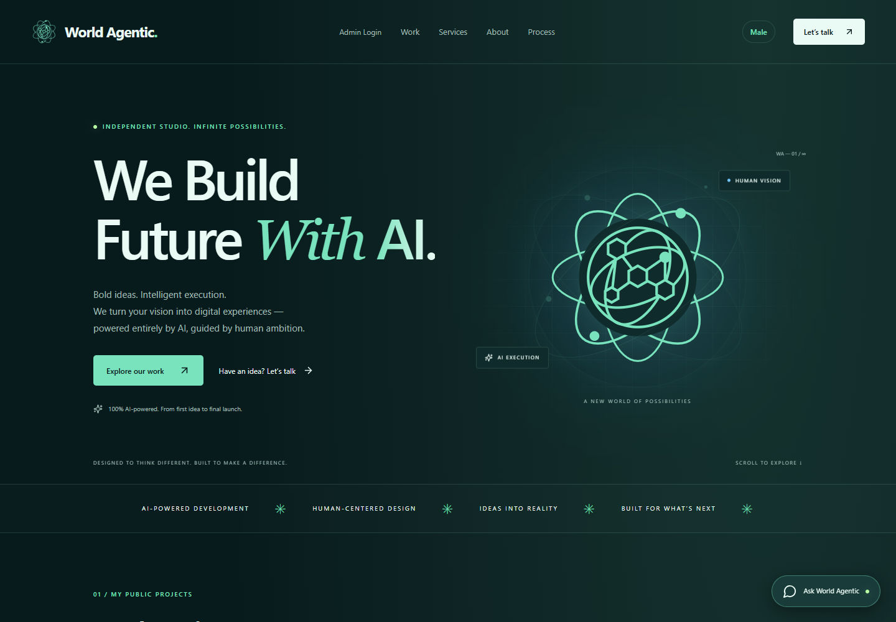
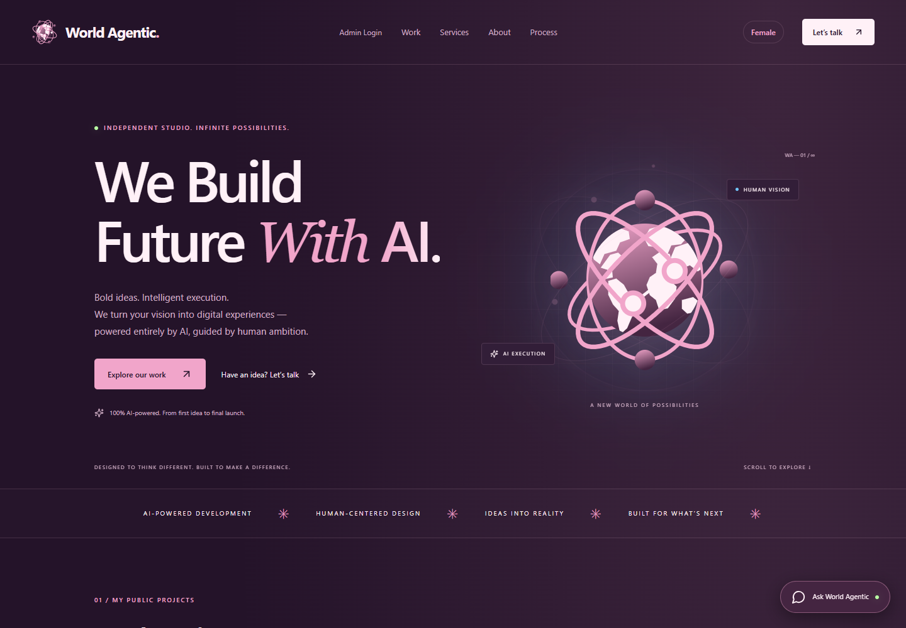

<div align="center">


# World Agentic

### Human vision. AI execution.

An independent digital studio by **Sarim Sheikh**.<br />
Ideas become websites, apps, and interactive experiences.


[Explore the code](client/src/world.tsx) · [Get started](#get-started) · [Deployment](#deployment) · [Contact](https://wa.me/923170046008)

</div>

---

## A personal welcome. A world of possibilities.

**Male theme**



**Female theme**



World Agentic brings the studio's services, project collection, and AI workflow together in one portfolio. Visitors enter their name, see a personalized animated welcome, and explore real projects and the ideas behind them.

| Experience | What you will find |
| :--- | :--- |
| ✨ Personal welcome | Browser name prompt with an in-page fallback and personalized greeting. |
| 🌌 Animated introduction | Aurora lights, orbiting particles, a celebration burst, and shimmering text. |
| 🎨 Two color styles | **Male:** navy and electric blue. **Female:** plum and rose pink. The introduction blends both palettes. |
| ◈ Adaptive branding | SVG logos follow the theme's accent color. Theme preferences are saved locally. |
| 🧩 Project showcase | Category filters, previews, and account-based access to demos and source links. |
| 💬 Studio assistant | Local replies about services, pricing, projects, and the AI workflow. |
| ↗ Start a conversation | Contact form prepares a WhatsApp message for the visitor to confirm and send. |

The interface adapts to desktop and mobile screens. Welcome animations respect the browser's reduced-motion preference.

## Built with

| Layer | Technology |
| :--- | :--- |
| Interface | React 19 · TypeScript · Vite · Tailwind CSS · Lucide icons |
| Animation | CSS animations · GSAP |
| API | Express 5 · TypeScript · Zod |
| Data | PostgreSQL · optional PGlite for local development |
| Accounts | Argon2id password hashing · server sessions · CSRF protection |
| Media & checks | Sharp · optional S3 storage · Playwright |

## Get started

Requires **Node.js 22.12 or newer** and npm. These commands use Windows PowerShell; use `npm` instead of `npm.cmd` on other systems.

```powershell
git clone https://github.com/SarimSheikh1/Portfolio.git
cd Portfolio
npm.cmd ci
npm.cmd run dev
```

| Local service | Address |
| :--- | :--- |
| Website | http://127.0.0.1:8787 |
| API | http://127.0.0.1:3001 |

Without database configuration, the server can serve the bundled public project snapshot. Visitor accounts and owner persistence need a configured database.

### Enable accounts and persistence

```powershell
Copy-Item .env.example .env
```

Edit `.env` with your database connection and a random `SESSION_SECRET` of at least 48 characters. Generate a value locally:

```powershell
node -e "console.log(require('crypto').randomBytes(48).toString('hex'))"
```

For the included PostgreSQL service, start Docker Desktop, then run:

```powershell
docker compose up -d db
npm.cmd run db:migrate
npm.cmd run owner:create
npm.cmd run seed:verified
npm.cmd run dev
```

Owner setup accepts a username and a hidden password of at least 14 characters. Visitor registration grants project-viewing access, not owner permissions. The **Admin Login** button opens owner sign-in. Private entry behavior uses the server's `OWNER_ENTRY_PATH` configuration.

<details>
<summary><strong>Local development without Docker</strong></summary>

Set `DATABASE_MODE=pglite` in `.env` to use an embedded PostgreSQL database in `data/local-postgres`. The development server applies the schema automatically. Optional owner configuration uses private `OWNER_LOGIN` and `OWNER_PASSWORD_HASH` values.

Stop the API before running database CLI commands against the embedded database. Production uses `DATABASE_URL` with PostgreSQL.

</details>

## Project structure

```text
Portfolio/
├── client/
│   ├── public/brand/       # SVG logos and brand assets
│   ├── public/previews/    # Project screenshots
│   └── src/
│       ├── world.tsx       # Current site entry point
│       ├── world.css       # Themes and animations
│       ├── Welcome.tsx     # Name prompt and welcome screen
│       ├── PublicProjects.tsx
│       └── ProjectAccount.tsx
├── server/
│   ├── src/               # API, accounts, imports, and media
│   ├── data/              # Bundled project snapshots
│   └── migrations/        # Database schema
├── shared/                # Shared types and curation
├── scripts/               # Maintenance and verification
├── tests/                 # Core and browser tests
├── evidence/              # Discovery and capture records
└── docs/                  # Technical and historical notes
```

## Useful commands

| Command | Purpose |
| :--- | :--- |
| `npm.cmd run dev` | Start the frontend and API. |
| `npm.cmd run typecheck` | Check frontend and server TypeScript. |
| `npm.cmd run build` | Type-check and build the frontend and API. |
| `npm.cmd start` | Start the compiled Express server. |
| `npm.cmd test` | Run core tests. |
| `node scripts/check-welcome.mjs` | Check the prompt, fallback, logo colors, dismissal, and mobile welcome layout against the running local site. |
| `npm.cmd run import:github` | Refresh GitHub project imports for review. |

The welcome browser check uses installed Google Chrome. Older UI suites describe earlier portfolio versions; review their routes and fixtures before using them as coverage for the current site.

## Deployment

### Frontend — Vercel or Netlify

Import the repository using its **root directory**. Included hosting files configure:

```text
Install:  npm ci
Build:    npm run build
Output:   client/dist
```

Host the API separately for accounts and API-backed features. Set `VITE_API_URL` to the API's HTTPS origin in the frontend build environment, then rebuild. Set the API's `PUBLIC_ORIGIN` to the exact frontend origin.

The old `client/public/projects.json` fallback is no longer used. Static hosting provides the frontend; it does not run Express or a database.

### Full application — Node hosting

```powershell
npm.cmd run build
npm.cmd start
```

Run from the repository root. Production requires `NODE_ENV=production`, `DATABASE_URL`, and a strong `SESSION_SECRET`. Express can serve the built frontend and API together. Run migrations and owner setup against your production database before enabling authenticated features.

Use HTTPS and same-site frontend/API domains where possible for session cookies. Keep environment files, database credentials, and provider tokens private. `VITE_*` variables are public browser values. Persistent uploads require durable storage, such as configured S3 media storage.

<details>
<summary><strong>Advanced maintenance and historical notes</strong></summary>

- [Earlier implementation guide](docs/legacy-implementation.md): provider imports, media processing, capture-worker isolation, and previous deployment notes. Some sections refer to the earlier studio interface.
- [Historical verification](docs/verification.md): recorded checks and environment limitations for the previous portfolio version.
- [Public evidence](evidence/): repository metadata and captures. These are snapshots, not guarantees of current external demo availability.

Automated screenshot capture requires an externally isolated worker with public-only network access. `CAPTURE_EGRESS_ISOLATED` is an operator declaration, not a firewall.

</details>

---

<div align="center">

### Have an idea? Let's build its next chapter.

[**Contact World Agentic on WhatsApp ↗**](https://wa.me/923170046008)<br />
[Sarim Sheikh on GitHub](https://github.com/SarimSheikh1)

**Human vision. AI execution.**

</div>
